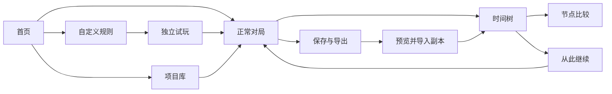

# 2048 Sandbox 主要页面线框

**版本：** 交互线框 v0.1  
**日期：** 2026 年 10 月 14 日  
**定位：** 检查信息结构和操作语义，视觉样式为初稿。

本文保留 M0 示例线框；真实游戏已实现至 M5，当前编辑、统计、节点比较和手机树交互见 [M5 操作说明](交互与统计_M5.md)及[M5 验收记录](../planning/M5_验收记录.md)。

可打开 [交互页面线框](页面线框.html)。该文件自包含，使用预置示例数据；页面切换、节点预览、分支策略、示例撤销、配置校验与节点比较可操作。真实引擎、持久化和文件导入导出属于后续实现，不把演示提示当作真实存档成功。

## 1 导航与布局

PC 使用左侧主导航，内容区随页面调整。常见页面为首页、对局、规则配置、时间树、节点对比、导入导出和项目库。手机改为顶部横向导航、单列内容，节点详情位于树下，重要按钮保持可触达。



## 2 首页与项目库

首页首先显示最近活跃对局：模式、节点、节点分数、最近保存状态。主动作是“继续对局”，并列提供正常模式、自定义配置、导入项目和项目库。

项目库每行显示项目名、对局数、节点数、活跃节点分数、最近保存时间和归档状态。筛选、命名、复制及归档属于项目元数据。完整项目库备份入口与单项目导出分开，避免用户误以为只导出当前棋盘就是全局备份。

空库显示新建入口；损坏项目显示恢复诊断；不支持的规则显示只读状态。跨项目切换前等待当前提交结束，未保存失败时不隐藏失败状态。

## 3 游戏页

```text
模式  规则版本  项目名                         保存状态  导出
节点 S4     分数 12     有效操作 3     规则回合 3

           棋盘                       当前目标
           方向输入                   技能与余量
                                      节点信息

暂停 / 继续       保存检查点       时间树       修改规则
```

棋盘旁明确区分有效操作数和规则回合数。技能卡显示次数或无限、冷却和目标；不能使用时说明具体原因。正常模式不展示可用技能，不开放原地修改经典规则；“修改规则”派生自定义版本。

保存状态至少区分“已保存”“正在提交”“保存失败”。动画只反映已提交结果。失败对局仍可查看历史、保存检查点和导出；允许挽救的技能按规则开放。

如果已选择旧节点作为下一次操作的父节点，顶部显示“将从 S1 继续”，保留“返回当前活跃节点”入口。正式动作提交前不改写持久化活跃位置。

## 4 自定义配置页

PC 左栏为九类参数，中栏为当前类表单，右栏为独立棋盘预览。手机将分类改为选择器，预览可单独展开。底部动作是校验、保存配置、开始新局。

每类分为基础、高级、实验。未实现能力显示阶段说明，不能提供会悄悄失效的开关。数字权重同时显示比例，不强迫玩家手算总和为 100%。无限次数打开后，次数输入禁用但保留草稿值，切回来可恢复。

错误在具体字段下显示，并禁用开始；警告允许继续。关闭生成时允许全零生成权重，开启生成后恢复校验。配置试玩使用临时副本，正式历史不被写入。对局中修改规则先展示差异和迁移预览，再提交新版本与子节点。

## 5 时间树

树节点至少显示 ID、分数、动作类型和当前/选中标记。当前活跃节点与预览节点使用不同标记。节点详情展示完整棋盘、规则版本、有效操作数、规则回合数、技能、随机策略、父节点及撤销目标。

选择节点只预览，不消耗技能。主动作“从此继续”先设置下一动作的父节点；该动作成功后才出现新子节点。可折叠、搜索、收藏和归档，缩放和平移属于视图操作。

“重新操作时的随机策略”设置默认重抽，可选复现【D02】。节点详情显示当时实际采用的策略。既有回放按钮不受该开关影响。

## 6 节点比较

左右各选一个节点并显示棋盘，比较分数、有效操作数、规则回合、技能余量、规则版本与随机上下文。格子差异用边框和文字标记，不能只靠颜色；数字 0 与空格分别显示。

不同尺寸使用左上坐标对齐并标记未匹配区域；同时提供各自完整棋盘。不同规则版本展示参数差异，不能仅显示分数高低暗示公平比较。

## 7 导入导出

导出先选范围：当前节点、当前路径、整个项目或项目库备份，再显示节点数、归档分支、必要恢复依赖和估算体积。格式、压缩等级和校验详情放在高级区域，普通玩家看到的是可以恢复什么。

导入先选择文件，展示项目名称、范围、节点数、规则能力、版本兼容和校验结果。默认“导入为副本”，不开启覆盖现有项目。计时对局导入后暂停，玩家明确继续后才运行。

## 8 八条重点流程

| 场景 | 关键反馈 | 对应决策 |
|---|---|---|
| 正常模式开始并移动 | 节点分数更新，成功后已保存 | D01、D04 |
| 修改配置并试玩 | 预览独立，错误定位到参数 | 基线自定义要求 |
| 保存检查点 | 名称与目标节点明确，不多算操作 | D03、D05 |
| 从 S1 继续形成新分支 | 原 S2 保留，新节点绑定自己的分数 | D01、D08 |
| 切换重抽与复现 | 影响新动作，原回放不变 | D02 |
| 成功使用撤销 | 父仍为当前节点，恢复目标另标，次数减少，操作数增加 | D03 |
| 导出再导入完整项目 | 树和规则一致，导入副本不覆盖原项目 | D05、D12 |
| 恢复计时对局 | 暂停提示与明确继续按钮 | D10 |

## 9 可访问性与错误状态

方向输入支持键盘与触控，表单不抢走游戏方向键。按钮可键盘聚焦，弹窗打开后聚焦首个字段，关闭后返回触发按钮，Escape 可关闭无未保存风险的弹窗。动态保存结果用适当的状态播报。

手机不能横向挤压三个内容栏；树画布可以在自己的容器内滚动，整页不应产生横向溢出。减弱动画不改变结算。大量节点时采用分段和折叠，不承诺把全部节点同时显示。

节点不存在、恢复校验失败、存储配额不足、事务冲突、规则不支持和导入损坏均需要明确反馈与可执行的下一步。技术字段留在详情和诊断区域，普通流程优先说明实际影响。
