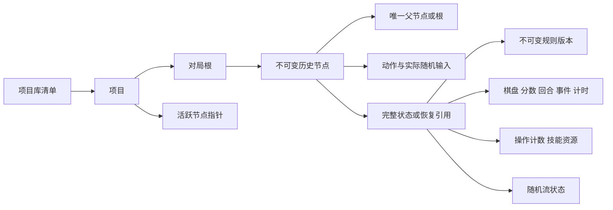

# 2048 Sandbox 状态与历史数据契约

**版本：** 补充设计 v0.1  
**日期：** 2026 年 10 月 14 日  
**状态：** 可供实现的技术草案。D01–D12 为已确认要求，本文件新增的字段、算法和撤销范围为建议方案。

**实现进展：** M1–M4 已实现。经典、历史和基础技能的证据分别见 [M1](../planning/M1_验收记录.md)、[M2](../planning/M2_验收记录.md)、[M3 验收记录](../planning/M3_验收记录.md)；规则编辑、迁移和高级事件见 [M4 操作说明](高级沙盒_M4.md)及[M4 验收记录](../planning/M4_验收记录.md)。计时仍属后续范围，文件布局与迁移见 [存档格式 v1](存档格式_v1.md)。

**M5 补充：** 批量编辑继续提交原有 edit 动作；统计、规则运行状态、节点比较、树总览与界面分页均只读，不进入 GameState 或状态摘要，不增加能力/Schema 版本。统计终点、标签、筛选、相机和矩形起点属于临时 UI。详见 [M5 操作说明](交互与统计_M5.md)和[M5 验收记录](../planning/M5_验收记录.md)。

本契约优先保证：节点各自拥有成绩，重新操作默认重抽但历史稳定回放，成功技能形成新节点，状态与活跃位置一起保存。当前 schemaVersion=1 通过 editing-v1、advanced-v1、events-v1 扩展；既有规则和状态不补写新字段，摘要保持兼容。

## 1 实体关系

库、项目、对局与节点的 ID 独立。相同棋盘或完整状态不合并节点【D08】；相同状态的底层数据可以共享【D12】。分支由父子路径推导，首版不另建会与路径冲突的分支状态副本。

M2 实现中，一个项目记录对应一局，节点键为 `[matchId, id]`，operationId 在项目内唯一。导入副本只映射项目 ID，保留节点 ID、父链和 undoStack，因此完整状态及其摘要无需改写；检查点另分配本地 ID。来源批次、原项目 ID、文件摘要和归档根标记作为项目元数据保存，不参与游戏状态摘要。

## 2 基础类型与版本

| 类型 | 约定 |
|---|---|
| ID | 非空 ASCII ID；正式实现建议 UUID，样例使用 S0 等便于阅读 |
| IntText | 非负精确十进制整数字符串；运算用 BigInt，存储不用浮点数【D07】 |
| Hash | `sha256:` 加 64 个小写十六进制字符 |
| UInt | 不超过 2⁵³−1 的非负整数，计数溢出拒绝提交 |
| RuleRef | `{ id, version }`；必须定位到已导出的规则版本 |
| 时间 | 墙上时间仅作元数据；游戏使用明确记录的逻辑毫秒数 |
| 格式版本 | `schemaVersion=1`；本轮是设计契约版本，不表示已有游戏引擎发行版 |

状态摘要对规范化 JSON 的 UTF-8 字节计算。首版限定所有对象键为 ASCII，数值仅为安全整数或 IntText：键按字典序递归排序、无多余空白、保留 Unicode 字符，不包含自身摘要。此受限编码需用跨语言样例校验，不能声称覆盖任意 JSON 的完整 JCS 实现；设计参考 [RFC 8785](https://www.rfc-editor.org/rfc/rfc8785)。

## 3 规则版本

`RuleSetVersion` 包含 `schemaVersion`、`id`、`version`、`name`、`requiredCapabilities`、`definition`、`definitionHash`。摘要只覆盖 definition；名字不影响规则结算。

definition 对应 [参数字典](规则参数字典.md)。发布到对局的版本不可变；草稿另存。节点改变规则时同时写入新版本和子节点【D09】，旧版本继续存在。导入缺少能力的规则时说明能力名称，不能悄悄忽略。

## 4 完整状态

`GameState` 包含 `schemaVersion`、`ruleRef`、`world`、`ledger`、`rng`、`undoStack`。节点成绩保存于 `world.score`，统计与缓存从节点派生【D01】。

| 状态域 | 必须保存的字段 | 作用 |
|---|---|---|
| `world.board` | rows、cols、按行排列的 cells；每格 tile 为 null 或 `{id,value,attributes}` | 区分空格与数字 0，恢复数字及属性 |
| `world.score` | IntText | 该节点自己的分数 |
| `world.roundCount` | UInt | 可被世界状态恢复的逻辑回合数 |
| `world.mergeCount` | UInt | 这条世界进度上的累计合并次数 |
| `world.goals` | 已完成目标、首次胜利记录 | 防止仅靠 UI 记住获胜 |
| `world.outcome` | playing、won、lost，及原因 | 明确还能否继续 |
| `world.events` | 队列、次数、冷却、临时效果、变量 | M1–M3 为空集合，扩展时完整保存 |
| `world.clock` | mode、logicalElapsedMs、remainingMs、statusAtCommit | 历史中的计时状态 |
| `ledger.effectiveActionCount` | UInt | 成功移动、技能、提交编辑等的有效操作数 |
| `ledger.chargedTurnCount` | UInt | 用于技能冷却和恢复的累计计费回合，撤销不回退 |
| `ledger.skills` | 每技能 charges、cooldownRemaining、usedCount、rechargeProgress | 防止撤销把本次或既有消耗一并恢复 |
| `rng` | 算法版本、state、increment、drawCount | 下一次操作可恢复的随机流 |
| `undoStack` | 可撤销的祖先节点 ID 栈 | 说明下一次撤销的目标，导出需要覆盖引用 |

数字块 ID 在给定输入下确定生成，不能在引擎内调用随机 UUID。建议从动作的确定性输入指纹加局部序号派生；节点 ID 则单独生成，不影响结算结果。

## 5 历史节点与会话

| `HistoryNode` 字段 | 含义 |
|---|---|
| `id`、`matchId`、`parentId` | 根的 parentId 为 null，其他节点恰有一个同局父节点 |
| `depth` | 根为 0，子节点为父深度 +1；与可回退的规则回合数不同 |
| `action` | 根为 null；其他节点记录实际提交的动作、参数与有效性类别 |
| `randomContext` | 本次 advance / reroll / reproduce、实际使用的 before 与 after 随机流 |
| `stateHash` | 规范化完整状态的摘要 |
| `stateRef` | 状态对象、全量快照或增量重建引用；不能仅存棋盘 |
| `createdAt`、`operationId` | 元数据时间与幂等提交 ID，不进入游戏状态摘要 |
| `undoTargetId` | 撤销目标的额外引用，不能代替 parentId |
| `tags` | 编辑、重抽、技能等来源信息；可更改的备注另存项目元数据 |

`Project` 保存根节点列表、持久化活跃节点、revision、检查点、归档标记及 preferences。`RunSession` 保存当前预览节点、待继续的父节点、播放状态、计时运行开关和未提交候选结果。

当前展开样例直接用 stateHash 定位 states 中的完整状态条目，尚不使用增量 stateRef；引入压缩与增量后再扩展恢复引用结构。

查看 S1 时可以继续让 S4 保持为活跃节点。点击“从此继续”仅选择下一次操作的父节点；成功提交新动作后才改变持久化活跃位置。恢复和导入后，实际计时会话为暂停【D10】，原节点的 statusAtCommit 仍忠实保留。

## 6 操作契约

| 动作 | 是否计入有效操作 | 是否推进规则回合 | 历史行为 |
|---|---|---|---|
| 成功方向移动 | 是 | 是 | 新子节点 |
| 经典无效方向输入 | 否 | 否 | 不提交、不抽随机数 |
| 成功技能，包括撤销 | 是【D03】 | 取技能参数 | 新子节点并自动保存 |
| 技能验证失败 | 否 | 否 | 返回诊断，状态不变 |
| 提交局面编辑 | 是 | 默认否 | 新子节点，记录差异 |
| 提交规则编辑 | 是 | 默认否 | 新规则版本与子节点一起提交 |
| 系统计时事件 | 否 | 否 | 需要持久化时为系统节点 |
| 浏览、比较、回放、标记检查点 | 否 | 否 | 会话或项目元数据，不伪造游戏动作 |

动作输入需显式携带 parentId、规则引用、操作类型、参数、逻辑经过时间、随机上下文与资源预算。核心结算不读取现实时间、浏览器状态、数据库或未记录的随机源。

结果为 `accepted`、`rejected` 或 `failed`：accepted 是可提交候选，数据库完成后才称为“已保存”；rejected 为规则拒绝；failed 为运算或存储错误。任何失败均不留下半步节点或技能消耗。

## 7 撤销的建议语义

本节细化 D03，属于本轮推荐方案。撤销是一种恢复世界状态的技能，不是移动时间树指针。

| 内容 | 撤销成功后的取值 |
|---|---|
| 棋盘、分数、规则回合、合并次数、目标、事件状态、逻辑计时 | 恢复目标节点的 world，随后应用本次明确的成本与规则效果 |
| 有效操作数 | 当前节点的值 +1 |
| 技能余量、使用统计、冷却、恢复进度 | 从当前节点继承，再支付本次撤销的成本；不复制目标节点的技能资源 |
| 累计计费回合 | 从当前节点继承；若该技能设置 advanceRound，再增加 1 |
| 随机流 | 从当前节点继承，避免技能撤销暗中把随机流倒回；历史导航复现另外处理 |
| 规则引用 | 保持当前版本；默认不跨规则版本撤销 |
| 父节点 | 当前节点，而不是被恢复的目标 |

每个成功且可撤销的非撤销动作，将动作前的父节点压入 undoStack。撤销取栈顶并弹出，不把自身再次入栈。修改规则默认清栈形成边界，玩家仍可通过历史树回到旧版本。

例如 S0→S1→S2：在 S2 撤销生成 U1，parentId=S2，undoTargetId=S1；U1 的分数和棋盘恢复到 S1，但操作数从 2 增至 3，撤销余量从 3 降至 2。再撤销生成 U2，父为 U1，目标 S0，操作数为 4、余量为 1。不能复制 S1 的旧余量把本次成本抹掉。

历史导航完全免费【D03】，因此玩家仍可主动回到旧资源状态并探索新分支。这符合沙盒自由度；技能资源规则只约束当前操作路径，不额外限制项目级探索。

## 8 重抽 复现与回放

| 情境 | 本次随机输入 | 已有历史 |
|---|---|---|
| 连续推进当前分支 | 当前节点 rng | 保留 |
| 从节点重新操作，默认 reroll【D02】 | 新建并记录随机流 before | 保留，新子节点记录新上下文 |
| 从节点重新操作，选择 reproduce【D02】 | 父节点 rng | 保留，即使结果相同也生成独立节点 |
| 回放已提交节点 | 该节点记录的实际 before、动作与时间 | 不抽新种子、不创建节点 |
| 只读查看 | 直接恢复该节点状态 | 不运算新的随机结果 |

重抽只改变新动作输入，不修改父节点。新的随机上下文在动作验证后生成，提交失败后的重试复用该上下文，避免保存故障偷偷变成再次重抽。两个新抽结果偶然相同不算错误；相同棋盘但随机流不同是不同完整状态。

建议随机算法标识为 `pcg32-xsh-rr-v1`，采用 64 位 state、奇数 increment 和 32 位输出。精确的掩码、种子初始化与取样顺序必须固定，参考 [PCG 官方最小实现](https://github.com/imneme/pcg-c-basic/blob/master/pcg_basic.c)。人工种子按 NFC 规范化文本，经带版本前缀的 SHA-256 派生初始化值；新重抽使用外部提供的随机种子并完整记录。

随机位置按索引升序排列候选；权重按规则数组顺序累计，用拒绝采样避免取模偏差；每个生成项先抽值再抽位置。bound=1 时直接取唯一候选，不消费随机数。算法升级使用新标识，旧回放保留旧实现或只读状态恢复。

## 9 提交与自动保存

1. 从持久化父节点恢复完整状态，验证动作与规则能力。
2. 准备固定的 operationId、随机上下文、逻辑时间与资源预算。
3. 计算完整候选状态和事件；摘要、压缩等异步工作在数据库事务外完成。
4. 开启读写事务，检查 project.revision 和预期父节点；处理幂等 operationId。
5. 一起写入规则版本（若有）、状态或增量、节点、索引和项目活跃位置，revision +1。
6. 事务完成后更新界面和动画，显示“已保存”；中断时恢复最后成功事务【D04】。

两个标签页同时写同一项目时，过期 revision 返回冲突，不覆盖新状态；提示刷新或从原父节点另开分支。operationId 已成功提交的相同重试返回原节点，不能重复扣次数。

空间不足时，保留上次已保存节点与内存候选，暂停继续输入，提供“重试保存”和“导出已保存项目”。不得把候选结果显示为持久化成功。浏览器存储需要外部备份，不能把数据库事务完成等同于永久不会被清理。

## 10 恢复与快照

M0 建议采用“完整快照 + 增量 + 摘要”，默认间隔 32 次操作。M1/M2 的本地数据库实际保存经摘要去重的完整状态；M2 可携带文件对根、检查点和周期边界保存完整快照，普通节点可用有界增量。具体编码与链长上限见 [存档格式 v1](存档格式_v1.md)。规则变更与撤销的强制快照边界随相应能力实现后细化。

恢复沿父链找到最近检查点，应用有序增量并校验目标摘要。增量是有版本的状态变化记录；不能在回放时依赖当下随机种子。快照去重覆盖完整状态，不仅是棋盘【D12】。归档不立即删除节点，垃圾回收必须计算节点、撤销目标、快照和资源的引用闭包。

单节点或分支导出必须包含撤销栈目标所需的数据，不能产生“导入后能看不能撤销”的隐性缺失。范围与格式见 [存档格式草案](存档格式草案.md)。

## 11 M4 实际契约

LoadedProject 提供以规则 ID/版本为键的规则池；rule 为当前保存节点的规则。预览、候选计算、恢复和逐节点回放都按 state.ruleRef 查找，不能用项目头的最新规则覆盖历史语义。

edit 动作携带唯一索引的非空 patches，value 为 IntText 或 null；旧规则首次编辑可带 nextRuleRef，同一步完成派生规则和棋盘修改。rule-edit 动作必须带 nextRuleRef 和 overflowPolicy。两个动作均使用 advance 随机上下文、增加有效操作数、不推进计费回合；存在新版本时清空 undoStack，普通编辑则入栈。

新规则、完整候选、节点与项目 revision 同事务提交；摘要和原规则回放预检在事务外完成。新版本只追加，固定经典派生自定义；旧节点继续保持旧尺寸、技能和生成语义。迁移详情见 [高级沙盒 M4](高级沙盒_M4.md)。

world.events 包含 counters、variables、可选 cooldowns 和提交时为空的 queue。变量为 IntText，执行计数/冷却为 UInt；旧无事件状态仍保留原空对象形状。事件运行状态随世界撤销，当前技能账本不退款。条件、动作、预算和失败诊断属于纯结算，未提交候选不会泄漏部分事件结果。

M4 文件对 rule-edit、带 nextRuleRef 的 edit 和撤销强制使用完整快照；引用闭包包括每个状态的实际规则版本。数据库继续保存完整状态，以完整状态摘要去重。

## 12 契约检查

样例与 Schema 位于 `examples/contracts/` 和 `schemas/`。必须检查：父子无环且同局、深度一致、规则引用完整、格子数量正确、数字与次数合法、状态摘要正确、撤销目标为有效祖先、活跃节点存在。

Schema 只能校验结构，不能证明移动和合并正确。M1/M2 的经典引擎、回放、事务故障、导入导出和离线浏览器流程，以及 M3 的九种技能、撤销成本和当前账本已通过应用测试；本节设计样例检查与应用测试分别记录。后续扩展规则需继续补齐语义验证。
